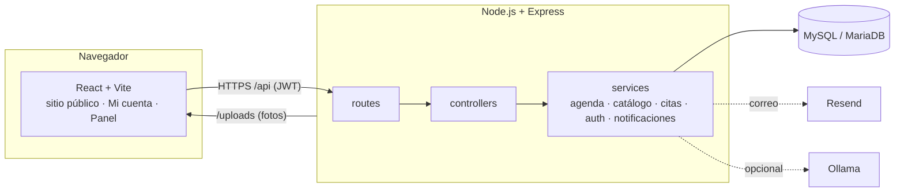

# Arquitectura del sistema (Fase 1)

## Visión general
Aplicación web de tres capas, con el frontend desacoplado del backend por una API REST con JSON:



## Estructura de carpetas
```
Epresedi/
├─ backend/
│  ├─ src/
│  │  ├─ config/        env.js (configuración validada) · db.js (pool + diagnóstico)
│  │  ├─ middlewares/   authMiddleware (JWT, roles, límites) · errorHandler · subida (imágenes)
│  │  ├─ routes/        una por área: auth, propiedades, atencion, portal, recursos
│  │  ├─ controllers/   reciben la petición, validan y responden
│  │  ├─ services/      reglas de negocio: agendaService, catalogoService, citasService, authService, usuariosService, notificationService, auditoriaService
│  │  ├─ utils/         errores, jwt
│  │  ├─ app.js         middlewares, API, archivos estáticos y sitio compilado
│  │  └─ server.js      arranque con diagnóstico y cierre ordenado
│  ├─ scripts/          instalarBD · crearUsuario · diagnostico
│  ├─ tests/            algoritmos.test.js (unitarias) · prueba_integral.mjs (extremo a extremo)
│  └─ uploads/          fotos subidas
├─ frontend/src/
│  ├─ publico/          Inicio, Catalogo, Asistente, FlujoCita, Cuenta, Acceso
│  ├─ admin/            Shell (menú por rol), Resumen, Calendario, Citas, Propiedades, Personas, Asesores, Reportes, Portal (propietario), Perfil
│  ├─ api.js · ui.jsx · charts.jsx · favoritos.js · styles.css · panel.css
├─ database/            01_instalar_esquema.sql · 02_catalogo_inicial.sql
├─ docs/                esta documentación y el diagrama ER
├─ Dockerfile · docker-compose.yml
```

## Flujo principal (cliente → asesor)
1. El cliente conversa con el **asistente** (tipo → comprar/arrendar → zona → presupuesto).
2. `POST /atencion/buscar` filtra y puntúa inmuebles `disponible` y guarda la búsqueda (historial).
3. Si no hay coincidencias o pide más, `GET /atencion/similares` recomienda según el historial.
4. Elige un inmueble → deja sus datos (`/atencion/interesados`) → elige un horario libre (`/atencion/disponibilidad`).
5. `POST /atencion/citas`: en una **transacción** se bloquean los asesores activos, se elige el de menor carga que tenga la franja libre y se guarda la cita con un código de gestión.
6. Se notifica al cliente y al asesor (correo + registro en `notificaciones`).
7. El asesor ve la cita en su **calendario**; la marca atendida/cancelada/reprogramada. El cliente puede cambiarla con su código o desde *Mi cuenta*.

## Roles y permisos
| Capacidad | Visitante | Cliente | Propietario | Agente | Administrador |
|---|:-:|:-:|:-:|:-:|:-:|
| Ver inmuebles disponibles, usar asistente, agendar cita | ✔ | ✔ | ✔ | ✔ | ✔ |
| Mi cuenta (citas, recomendaciones, lista, perfil) | | ✔ | | | |
| Portal del propietario (sus inmuebles, contratos, pagos) | | | ✔ | | |
| Calendario y citas propias | | | | ✔ | todas |
| Clientes interesados | | | | los suyos | todos |
| Ver inventario / cambiar estado y datos | | | | ver | ✔ |
| Alta de inmuebles y fotos | | | | | ✔ (con `PERMITIR_ALTA_INMUEBLES_ADMIN`) |
| Contratos, pagos, remodelaciones, visitas | | | | ✔ (sin eliminar) | ✔ |
| Registrar asesores/propietarios, horarios | | | | | ✔ |
| Reportes y análisis | | | | ✔ | ✔ (+CSV) |
| Registro de actividad | | | | | ✔ |

## Decisiones clave
* **JWT sin estado** (Fase 4): cualquier instancia del backend reconoce al usuario; no hay sesiones en memoria.
* **Fechas como texto** `AAAA-MM-DD HH:MM:SS` en hora de Colombia (UTC-5, sin horario de verano): evita corrimientos de zona horaria.
* **Reglas de negocio en servicios** (testeables sin base de datos).
* **Validación en dos niveles**: API y base de datos (triggers).
